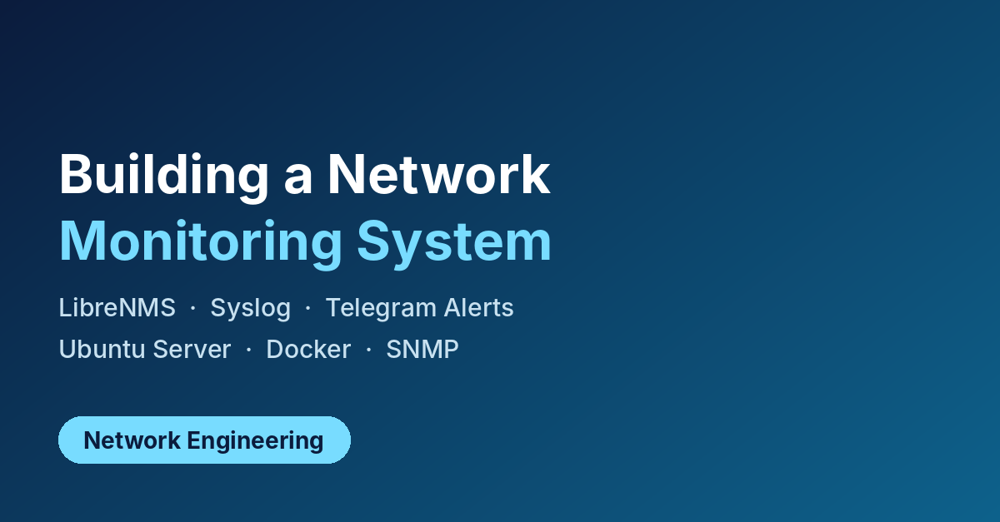
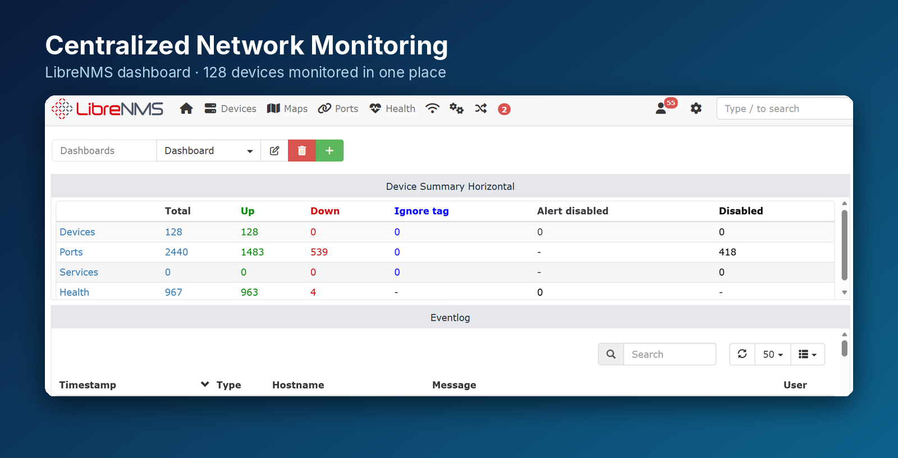
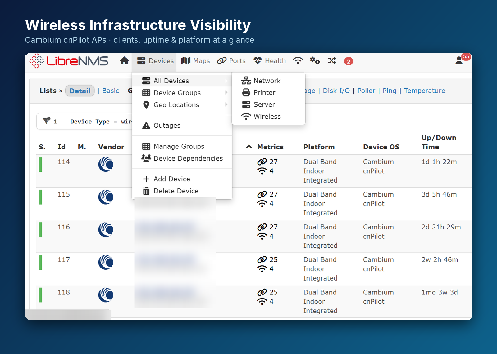
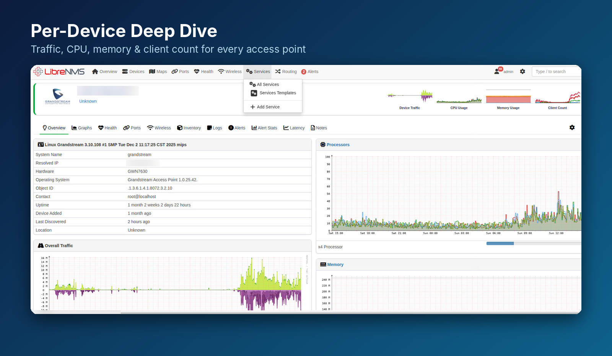
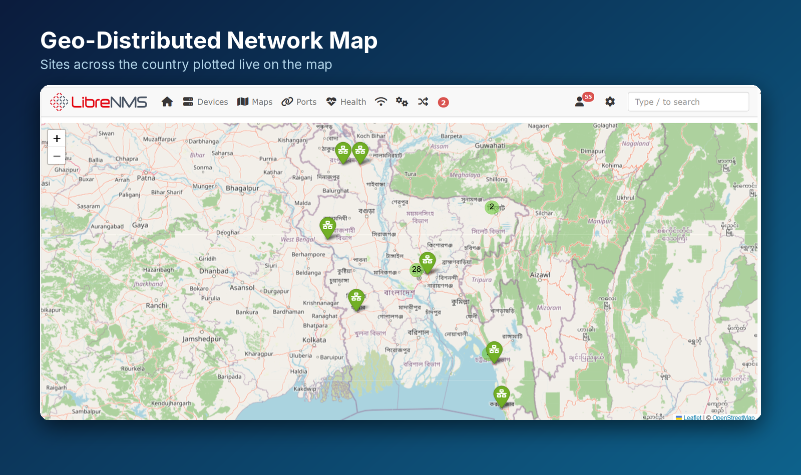
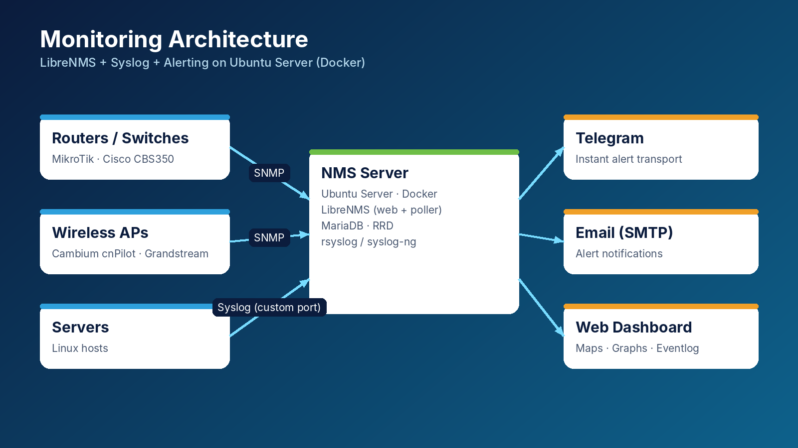

# LibreNMS Network Monitoring Setup

Centralized network monitoring with **LibreNMS** on Ubuntu Server (Docker), covering SNMP polling, Syslog, Telegram alerts and email alerts.

> **Note:** All IPs, ports, passwords and tokens in this guide are placeholders. Replace them with your own values.



## Screenshots






## Architecture



## Table of Contents

1. [Environment](#1-environment)
2. [Install Docker](#2-install-docker)
3. [Deploy LibreNMS](#3-deploy-librenms)
4. [Add devices via SNMP](#4-add-devices-via-snmp)
5. [Syslog](#5-syslog)
6. [Telegram alerts](#6-telegram-alerts)
7. [Email alerts (Microsoft 365 SMTP)](#7-email-alerts-microsoft-365-smtp)
8. [Maintenance](#8-maintenance)
9. [Security checklist](#9-security-checklist)

## 1. Environment

| Item | Value |
|---|---|
| Server | Ubuntu Server |
| Deployment | Docker + Docker Compose |
| Monitoring | LibreNMS |
| Protocols | SNMP v2c, Syslog (UDP 51514) |
| Alerting | Telegram, Email via Microsoft 365 SMTP |
| Monitored | MikroTik routers, Cisco CBS350 switches, Cambium cnPilot and Grandstream GWN7630 APs |

## 2. Install Docker

```bash
sudo apt update && sudo apt -y upgrade
sudo apt -y install ca-certificates curl
sudo install -m 0755 -d /etc/apt/keyrings
curl -fsSL https://download.docker.com/linux/ubuntu/gpg -o /etc/apt/keyrings/docker.asc
echo "deb [signed-by=/etc/apt/keyrings/docker.asc] https://download.docker.com/linux/ubuntu $(. /etc/os-release && echo $VERSION_CODENAME) stable" | sudo tee /etc/apt/sources.list.d/docker.list
sudo apt update
sudo apt -y install docker-ce docker-ce-cli containerd.io docker-compose-plugin
sudo systemctl enable --now docker
```

## 3. Deploy LibreNMS

Use the official `librenms/docker` compose example as the base.

```bash
mkdir -p /opt/librenms && cd /opt/librenms
git clone https://github.com/librenms/docker.git
cd docker/examples/compose
```

Edit `librenms.env`:

```ini
TZ=Asia/Dhaka
PUID=1000
PGID=1000
DB_HOST=db
DB_NAME=librenms
DB_USER=librenms
DB_PASSWORD=<STRONG_PASSWORD>
BASE_URL=http://<NMS_SERVER_IP>:38271
```

Start the stack:

```bash
docker compose -f compose.yml up -d
docker compose ps
```

Open `http://<NMS_SERVER_IP>:38271` and finish the web installer (admin user, validate).

## 4. Add devices via SNMP

### 4.1 MikroTik (RouterOS)

```
/snmp community set [find default=yes] name=<COMMUNITY> addresses=<NMS_SERVER_IP>/32 read-access=yes
/snmp set enabled=yes trap-version=2
```

### 4.2 Cisco CBS350

```
snmp-server server
snmp-server community <COMMUNITY> ro <NMS_SERVER_IP> view Default
```

### 4.3 Add in LibreNMS

Devices > Add Device. Set hostname/IP, SNMP v2c and the community. Or from the CLI:

```bash
docker compose exec --user librenms librenms lnms device:add <DEVICE_IP> --v2c -c <COMMUNITY>
```

> **Tip:** Restrict SNMP to the NMS server IP only. Where an ISP blocks SNMP over public IPs, poll over a VPN/tunnel instead.

## 5. Syslog

The LibreNMS container ships with syslog-ng. Enable it in `librenms.env`:

```ini
LIBRENMS_SYSLOG=true
```

In `compose.yml`, the syslog-ng service must publish the port:

```yaml
  syslogng:
    image: librenms/librenms:latest
    container_name: librenms_syslogng
    hostname: librenms-syslogng
    cap_add:
      - NET_ADMIN
      - NET_RAW
    env_file: librenms.env
    environment:
      SIDECAR_SYSLOGNG: 1
    ports:
      - "51514:514/udp"
      - "51514:514/tcp"
    volumes:
      - ./librenms:/data
    depends_on:
      - librenms
      - redis
```

Enable Syslog in the web UI (Settings > Global Settings > External > Syslog) or in `config.php`:

```php
$config['enable_syslog'] = 1;
```

Open the firewall:

```bash
sudo ufw allow 51514/udp
sudo ufw allow 51514/tcp
```

### 5.1 Send logs from devices

MikroTik:

```
/system logging action add name=nms-syslog target=remote remote=<NMS_SERVER_IP> remote-port=51514 src-address=<ROUTER_IP>
/system logging add topics=info,warning,error,critical action=nms-syslog
```

Cisco CBS350:

```
logging host <NMS_SERVER_IP> port 51514 severity informational
```

Verify in LibreNMS under Logs > Syslog, or on the server:

```bash
sudo tcpdump -ni any udp port 51514
```

The device must be added in LibreNMS with the same IP it sends logs from, otherwise entries are dropped as unknown hosts.

## 6. Telegram alerts

1. Create a bot with `@BotFather` and copy the token.
2. Add the bot to your group/channel, send a message, then get the chat ID from `https://api.telegram.org/bot<TOKEN>/getUpdates`.
3. In LibreNMS: Alerts > Alert Transports > Create transport.
   - Transport type: Telegram
   - Chat ID: `<CHAT_ID>`
   - Token: `<BOT_TOKEN>`
4. Alerts > Alert Rules > attach rules (Device Down, Port Down, High CPU) and select the Telegram transport (or add it to a Transport Group).
5. Test with Alert Transports > Test.

## 7. Email alerts (Microsoft 365 SMTP)

Settings > Alerting > Email options:

```
SMTP host: smtp.office365.com
SMTP port: 587
Encryption: STARTTLS
Username/Password: <MAILBOX>
From: <MAILBOX>
```

The M365 admin must enable Authenticated SMTP (SMTP AUTH) for that mailbox.

## 8. Maintenance

```bash
docker compose ps
docker compose logs -f librenms
docker compose exec --user librenms librenms lnms validate
docker compose pull && docker compose up -d
```

Backups: dump the MariaDB database and keep the `./librenms` and `./db` volumes.

```bash
docker compose exec db mariadb-dump -u librenms -p librenms > librenms-backup-$(date +%F).sql
```

## 9. Security checklist

- Restrict the SNMP community to the NMS IP only; avoid `public`.
- Put the web UI behind HTTPS (reverse proxy) and a firewall.
- Do not expose the Syslog port to the internet.
- Use a strong admin password and change default DB passwords.


---

**Author:** Jubair Rafique Sultan, Executive Network Engineer
